# Gallery

Every picture here was made by Easel itself (no third-party media): the style samples are frames
rendered by the engine from each style's demo, and the SVGs are the plugins' own examples, checked
by the tests. The HTML examples render with `node plugins/easel-core/engine/cli.mjs render_still
--json @args.json` (or ask Claude: "render this example").

## easel-motion: the style catalog

One frame from each style's short demo (`plugins/easel-motion/styles/<style>/demo/`; 6 seconds,
cut-paper's 8). Styles can be mixed inside one piece.

| | | |
| --- | --- | --- |
| 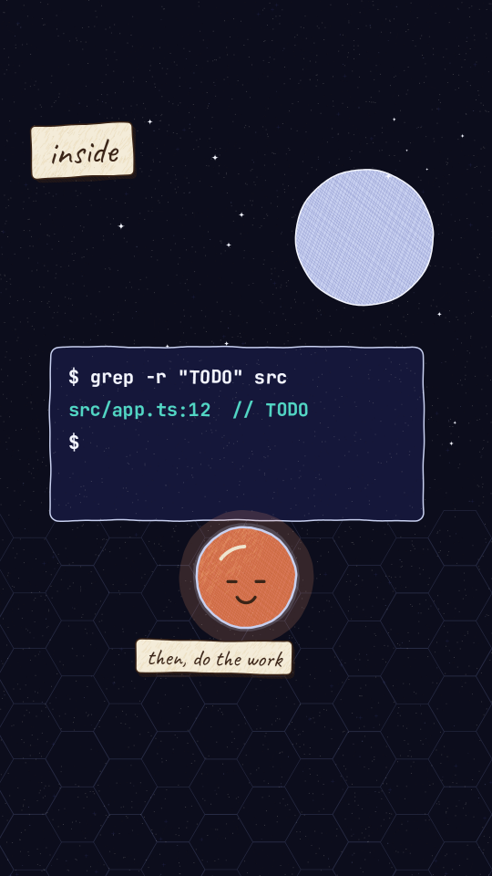 | 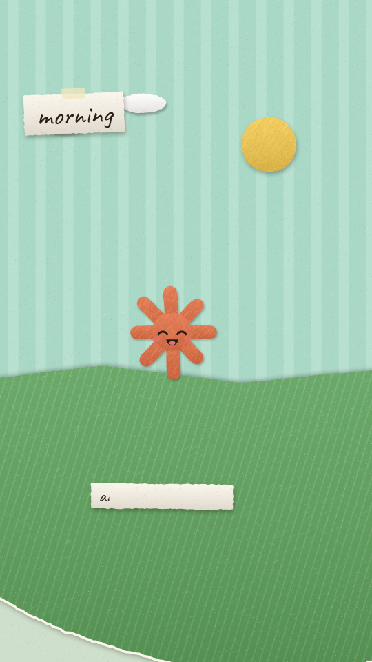 | 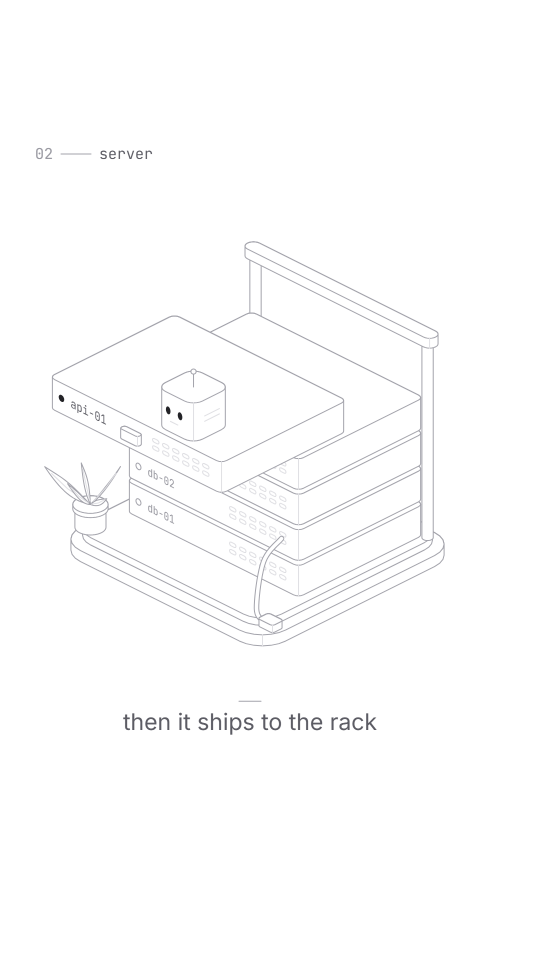 |
| `crosshatch` | `cut-paper` | `isometric` |
| 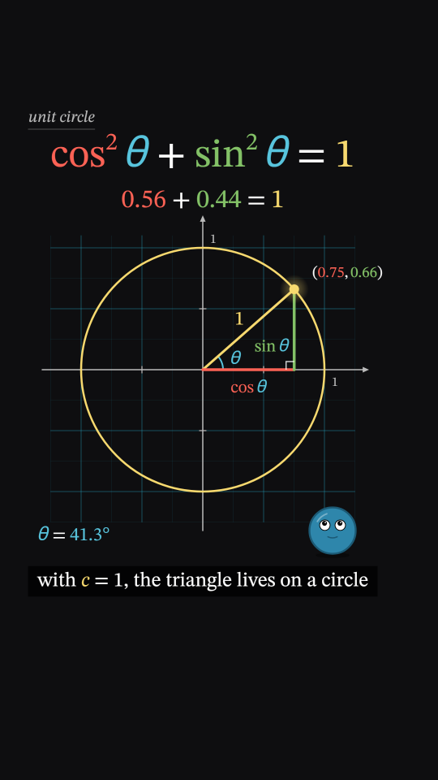 | 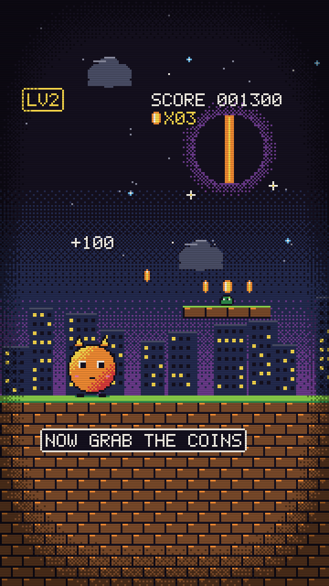 | 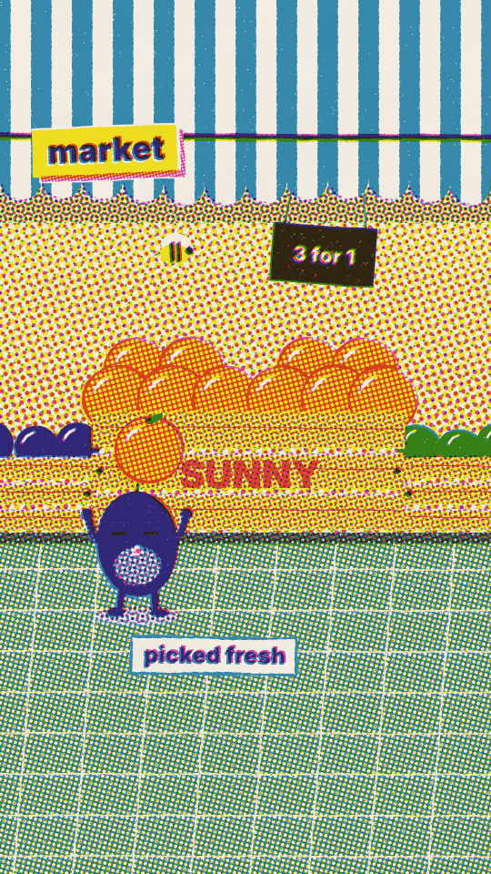 |
| `math` | `pixel` | `riso` |
| 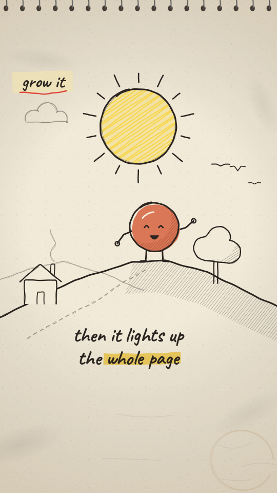 | 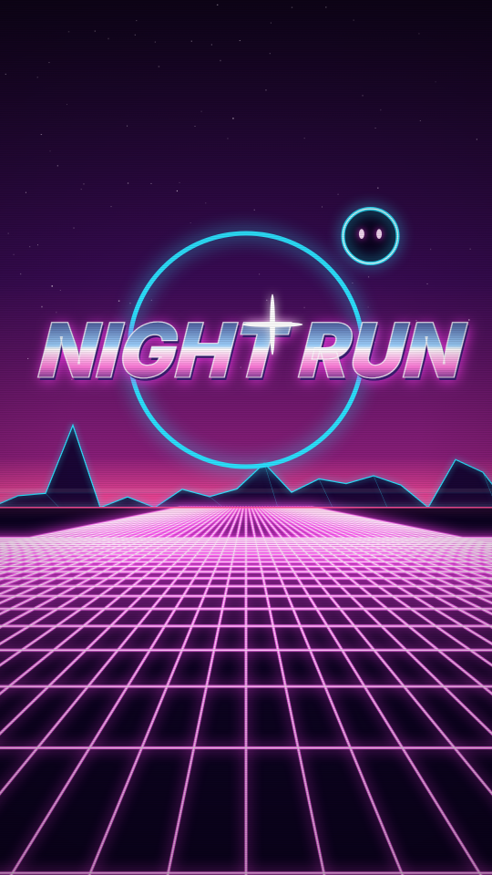 | 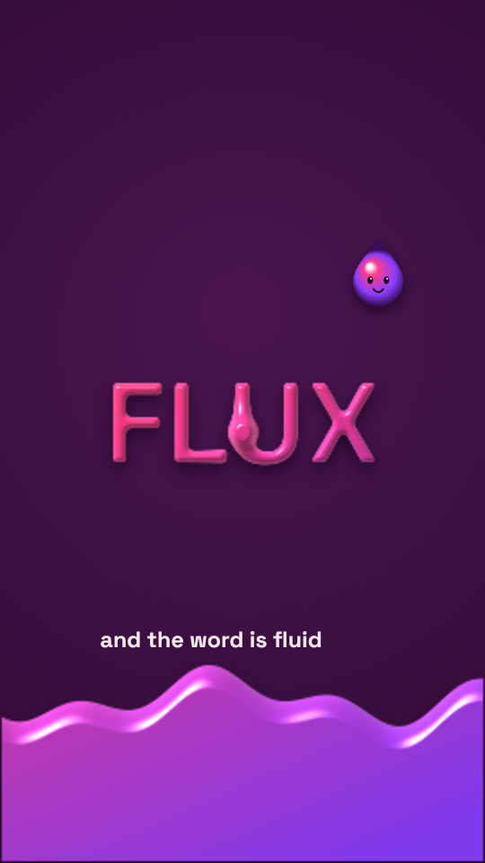 |
| `sketchbook` | `synthwave` | `liquid` |
| 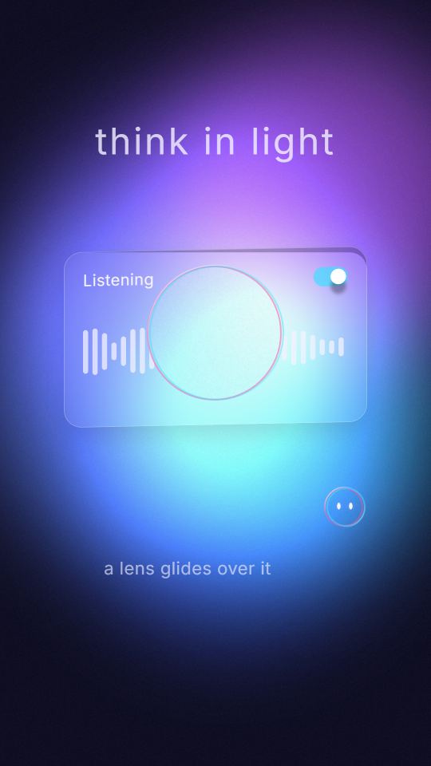 | 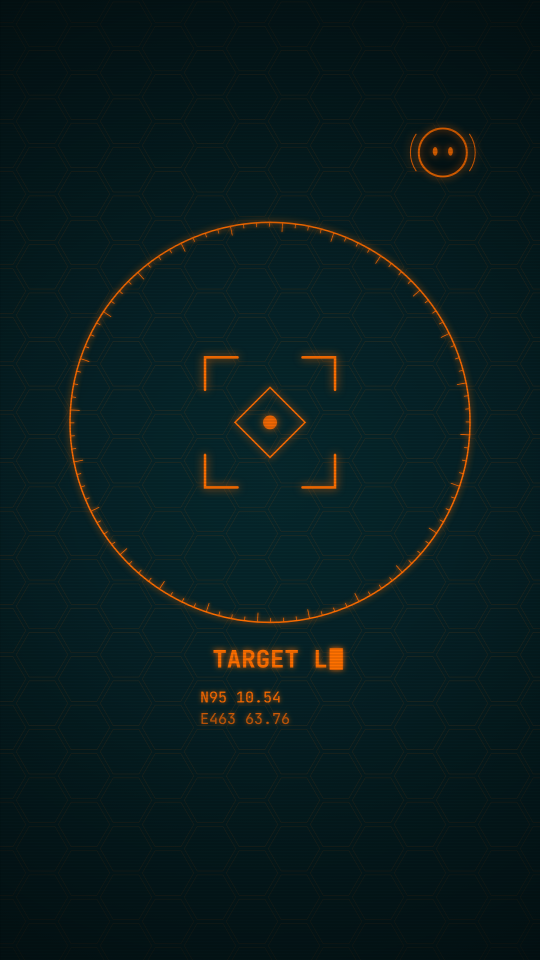 |
| `aurora-glass` | `hud` |

The style-match example (a style made from three reference sheets, compared on a 10% grid):

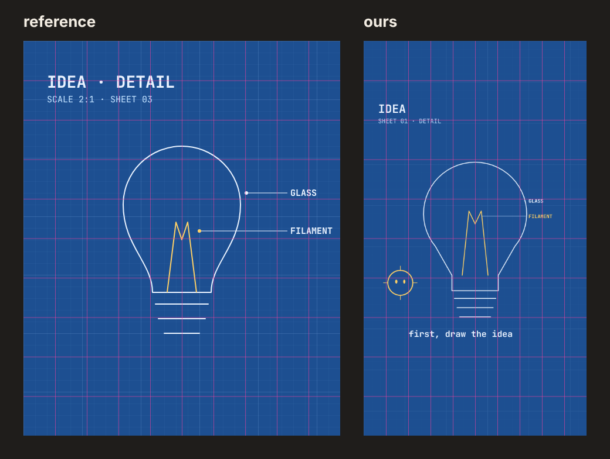

## easel-illustrate

| | | |
| --- | --- | --- |
|  | 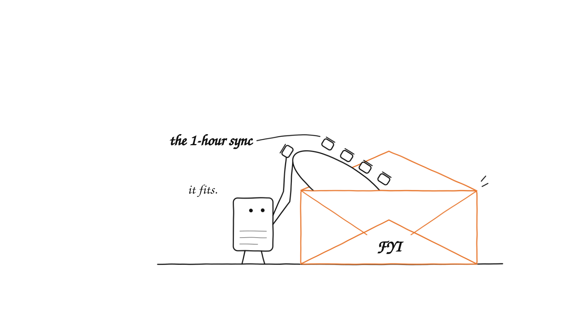 | 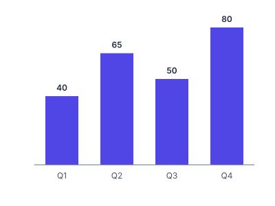 |
| `svg-illustration`: a lit scene | `concept-illustration`: one idea, the card mascot | `svg`: a chart (bars on the baseline, proportional) |
|  |  | `generative-art`: [tidal-script.html](../plugins/easel-illustrate/examples/generative-art/tidal-script.html), a seeded p5.js loop, with its [philosophy](../plugins/easel-illustrate/examples/generative-art/philosophy.md) |
| `svg`: a progress ring | `svg`: a CSS spinner (reduced-motion aware) | |

## easel-design

| | | |
| --- | --- | --- |
| 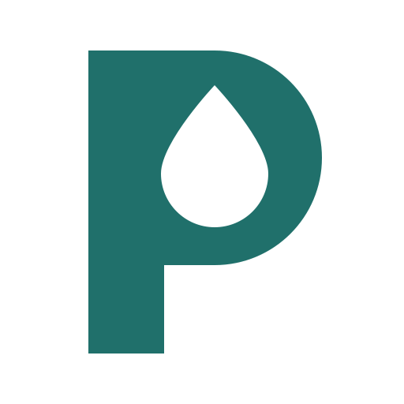 | 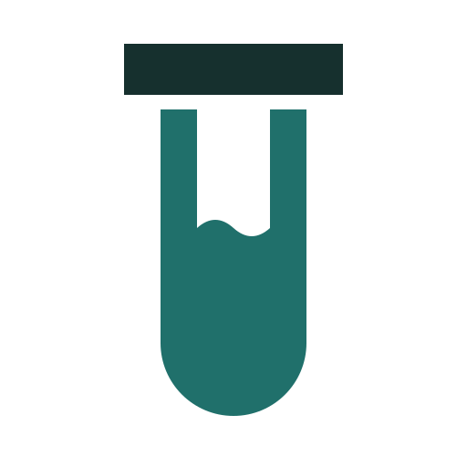 | 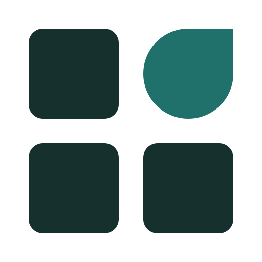 |
| `logo`: three concepts | (each checked on a 16-512 px ladder, light and dark) | |

Icons (`icons`, a 24 px grid, `currentColor`):
       

Pages (HTML; every one is rendered and checked by the tests, PDFs at their print size):
[feed post](../plugins/easel-design/examples/social-graphic/feed-post-1080x1080.html),
[story](../plugins/easel-design/examples/social-graphic/story-1080x1920.html),
[ads](../plugins/easel-design/examples/ad-creative/),
[A3 poster (PDF)](../plugins/easel-design/examples/poster/poster-a3.html),
[infographic](../plugins/easel-design/examples/infographic/home-delivery.html),
[deck (PDF)](../plugins/easel-design/examples/presentation/members-meeting.html),
[UI states](../plugins/easel-design/examples/ui-design/component-states.html),
[mobile screen](../plugins/easel-design/examples/ui-design/mobile-bills.html),
[landing page](../plugins/easel-design/examples/landing-page/home-physio.html),
[design-system specimen](../plugins/easel-design/examples/design-system/specimen.html),
[brand card (PDF)](../plugins/easel-design/examples/brand-identity/card.html),
[three directions](../plugins/easel-design/examples/directions/).

## easel-ai-media and easel-pixel

No gallery yet: their outputs come from your own provider account or your own Aseprite, and the
Easel project has not made live paid generations or drawn in Aseprite (both are on the owner's
list in the run report).
